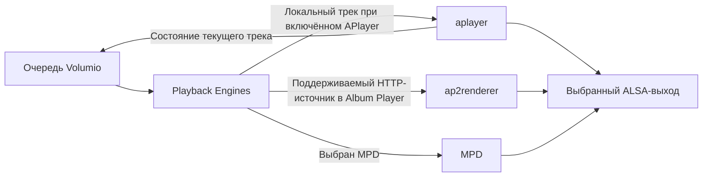

# APlayer для локальной музыки в Playback Engines

Статус: спецификация внедрения. Целевая система — Volumio 4 на Raspberry Pi,
Bookworm ARMHF. Базовая версия полноценного `aplayer` — 2.21.
[Результаты проб на Pi](../../research/2026-11-23-aplayer-integration.md).

## Поведение в Volumio

В настройках Playback Engines внутри **Album Player** появляется поле
**Локальное воспроизведение** с вариантами **Рендерер** и **APlayer**.
При обновлении существующих установок и в чистой установке выбран **Рендерер**.
Применение настройки для активного Album Player останавливает воспроизведение.
Настройку можно изменить при выбранном MPD без прерывания MPD.

| Сценарий | Транспорт |
| --- | --- |
| Управление Playback Engines выключено | Штатные сервисы Volumio |
| Выбран MPD | MPD по существующему контракту |
| Выбран Album Player и локальный режим «Рендерер» | `ap2renderer` |
| Выбран Album Player и локальный режим «APlayer», трек из локальной библиотеки | `aplayer` |
| Qobuz, Яндекс Музыка и другие поддерживаемые HTTP-источники при выбранном Album Player | `ap2renderer` |

Локальная библиотека включает диски и уже смонтированные NAS-папки из
`/mnt/USB`, `/mnt/NAS` и `/mnt/INTERNAL`. Выбор транспорта определяется
источником и настройкой до запуска файла. Ошибка APlayer видна в интерфейсе и
останавливает воспроизведение. Повторная попытка идёт через выбранный транспорт.

Первая версия поддерживает обычные WAV/FLAC, отдельные DSF/DFF и CUE с
поддерживаемыми PCM-источниками. SACD ISO и CUE с DSD-источниками вне скоупа.
Бесшовные переходы для APlayer не входят в обещанный контракт.

## Единственная очередь

Volumio выбирает текущий и следующий элемент, включая Repeat, Shuffle, Consume,
Next, Previous и изменения списка. `aplayer` видит каталог с **одним файлом**
и работает с `auto_mode=false` и `gapless_mode=false`. AP3, нативный плейлист
из нескольких записей и синхронизация очередей не нужны.

Адаптер открывает новую сессию на каждый выбор трека, в том числе на повтор той
же записи. Использует существующие проверки владельца и поколения в Manager.
После каждого асинхронного шага сверяет актуальность запроса. Изменение списка,
которое оставляет текущий элемент активным, применяется Volumio на следующем EOF.
Если текущий элемент заменён или управление передано другому источнику, старые
результаты сканирования, Play и State не меняют состояние очереди.

### Запуск трека

1. Разрешить исходник через существующую проверку путей и типа файла.
2. Заменить содержимое приватного слота. Для обычного файла использовать
   симлинк на проверенный канонический путь. Использовать новое имя на запуск,
   сохраняя расширение. Для CUE использовать подготовленный WAV.
3. Через локальный HTTP API загрузить выделенный каталог. Дождаться
   `Scanning=false`, убедиться в наличии ровно одного трека и совпадении
   `GetPath` с ожидаемым путём. Старый каталог после асинхронного сканирования
   не считается успешным результатом.
4. Назначить Playback Engines источником обновлений для state machine Volumio,
   сохранив `service=mpd` и исходный URI трека. Вызвать `Play&album=0&song=0`.
   Публиковать позицию в миллисекундах, длительность для Volumio в секундах.
   Заголовки, обложка и URI берутся из записи Volumio, включая CUE.

### Транспорт и EOF

- Изолированный адаптер реализует `playLocal`, `pause`, `resume`, `seek`,
  `stop`, `close` и публикацию состояния через существующий контракт транспорта.
  `Pause` в APlayer — переключатель. Команда отправляется лишь при переходе
  в нужное состояние. Повторная пауза или resume не сбрасывают позицию.
  Seek переводит миллисекунды в процент от подтверждённой длительности записи.
- Принятое `Play` ещё не доказывает старт. Проверять начальное состояние сразу
  после команды, затем опрашивать без параллельных запросов. Нормальное
  завершение требует подтверждённого старта, последующего `Playing=false`,
  пустого `LastError` и признака достижения конца по позиции и длительности.
  Учитывать измеренную на Pi задержку отчёта позиции. Длительность служит
  проверкой события, запуск следующего трека по таймеру запрещён.
- На подтверждённом EOF адаптер отправляет ровно один `stop` через
  `syncState` действующей сессии. Volumio самостоятельно продвигает очередь.
  При ручном Stop, Next, Previous или смене источника сначала аннулировать
  сессию, затем останавливать вывод. Эти остановки не публикуются как EOF.
- Ошибка API, аварийный выход процесса, преждевременный stop и трек без
  подтверждённого старта завершаются явной ошибкой. Для коротких треков
  проверка на Pi должна подтвердить, что опрос успевает зафиксировать старт
  или что доступен другой подтверждённый сигнал. Если данных недостаточно,
  не двигать очередь на основании одного `Playing=false`.

## Форматы и профили

| Источник | Что получает APlayer |
| --- | --- |
| WAV, FLAC | Исходный локальный файл |
| `cue://…@index`, `…cue/trackNNNN` с PCM | Отдельный WAV с исходной частотой, каналами и точными границами в семплах |
| DSF, DFF | Исходные байты DSD, без подготовки WAV |

Для обеих форм URI CUE переиспользовать текущий парсер и подготовку сегмента.
Сопоставлять позицию из Volumio с фактической записью CUE. Legacy `@index`
считает с нуля, виртуальный `trackNNNN` — с единицы. Учесть номера `TRACK`,
начинающиеся с 03, и несколько `FILE`. Последний трек каждого файла ограничен
его EOF. Хранить сегмент до закрытия использующей его сессии. Применяются
существующие ограничения размера, времени подготовки и разрешённых корней.

Профили Album Player общие на уровне пользовательских настроек. Нативный
сериализатор `SetConfig` строится по форме из архива APlayer и отдельно
проверяет прочитанные значения. Программная громкость направляется активному
транспорту. При запуске применяется сохранённая громкость и состояние mute.

- **Без обработки.** PCM проверяется на соответствие выбранному ALSA-выходу.
  Для DSF/DFF разрешён только Native DSD при успешной проверке совместимой
  упаковки, частоты и каналов. При отказе — явная ошибка с предложением
  выбрать пользовательский режим. Автоматического перевода в PCM нет.
- **Пользовательский режим.** Существующий выбор PCM / DoP / Native DSD
  применяется к локальному транспорту. Для DoP и Native DSD проверяются
  целевые параметры и фактический ALSA-вывод. Опции обработки и громкость
  выставляются только через подтверждённые настройки APlayer. Если активный
  профиль требует неподдерживаемую опцию, сохранение или запуск сообщает,
  какая опция недоступна. Существующий профиль пользователя сохраняется.

## Интеграция и владение устройством

- **Настройка.** В `lib/profiles.js` добавить `localAlbumPlayer` со значениями
  `renderer` / `aplayer`. Валидатор загружает старые настройки со значением
  `renderer`, сохраняя профили, выбранное устройство и прежний `engine`.
  UI в `index.js` показывает выбор и фактический процесс вывода. Существующее
  поле состояния `engine` сохраняет значения `mpd` / `album_player`.
- **Маршрутизация.** Manager выбирает фактический транспорт при подготовке
  записи. Делегат APlayer живёт внутри Playback Engines. Точка входа
  `clearAddPlayTrack` и интерфейс внешних клиентов Qobuz/Яндекс Музыки
  сохраняют текущие контракты.
- **Сервис.** Установщик получает официальный ARM32-архив APlayer 2.21 и
  проверяет SHA-256
  `030ff12da35d07be4842959ae6bce9b2e271777849afb59d14e1e80590c41397`.
  Переиспользовать правила проверки архива рендерера. Собственные
  конфигурация, рабочий каталог и слот. Запуск через systemd по запросу
  Manager, штатный `Type=forking`, от `volumio` с группой `audio`.
  HTTP-сервер работает в `PrivateNetwork=yes`. Связанные unit прокси и
  сокета предоставляют API через Unix-сокет с режимом 0600. После рестарта
  APlayer прокси присоединяется к новому namespace. Установщик готовит unit'ы
  без автозапуска. Ошибка установки APlayer не ломает доступность MPD и
  рендерера и видна при выборе APlayer.
- **ALSA.** Manager последовательно выполняет переходы. Перед запуском другого
  транспорта ждёт завершения старого процесса и освобождения устройства.
  Ручной Stop освобождает PCM. Если `aplayer` удерживает его после Stop,
  Manager завершает сервис через systemd.
  При повторном запуске на том же транспорте процесс можно сохранить, если
  устройство освобождено и предварительная проверка нового формата проходит.
  MPD-output policy и привязка к выбранному устройству остаются в Manager.
  Проверять `MainPID` и владельца PCM из ALSA. Диагностика различает
  `aplayer` и `ap2renderer` под общим выбором Album Player.
- **Остановка и откат.** При отключении плагина, смене устройства и удалении
  плагина завершить сессию, остановить сервис и сокет, убрать только
  принадлежащие плагину временные данные. Откат пользователя — выбрать
  «Рендерер» в той же настройке, без удаления профилей или медиатеки.

## Порядок внедрения и приёмка

1. Установщик, unit'ы и приватный API. На Pi проверить реальный `MainPID`,
   Unix-сокет, отсутствие слушающих TCP-портов APlayer в сети хоста,
   повторный запуск и очистку после Stop/disable/uninstall.
2. Локальный адаптер и наблюдение ALSA. В тестах проверить подтверждение пути,
   отмену сканирования, поздние ответы State, идемпотентность паузы и EOF,
   ошибку старта, аварийное завершение и владение устройством. На Pi
   воспроизвести WAV/FLAC через настоящую очередь Volumio.
3. Добавить PCM CUE, DSF/DFF и проверку профилей. Снять на ALSA loopback CUE
   `3 → 1 → 3`, ровно по 44 100 ожидаемых ненулевых кадров на запись, без
   чужих кадров. Прогнать обе формы URI, CUE с номерами 03–05 и несколько
   `FILE`. DSF/DFF должны завершаться в PCM, DoP и Native DSD с ожидаемыми
   параметрами ALSA и контрольными данными. Проверить громкость, Pause,
   Resume, Seek, Stop и смену формата.
4. Проверить обычные и короткие записи, Repeat, Shuffle, Consume, ручной
   Next/Previous, изменение списка на ходу и переходы
   `aplayer → ap2renderer → aplayer` и `aplayer → MPD`. Прогнать
   действующие тесты Playback Engines и общих транспортов, собрать пакет,
   проверить обновление и ручной откат настройки. Проверить FiiO перед
   заявлением поддержки этих режимов на физическом ЦАПе. Результат loopback
   фиксируется отдельно от аппаратного результата.
